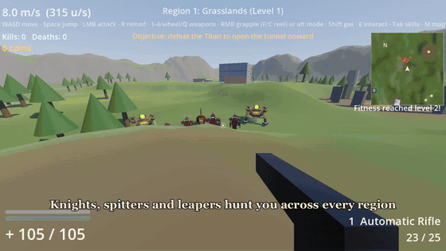

# Crusaders

A first-person action game built in Godot 4. Bunny hop across a procedurally generated world, cut down packs of enemies, then grapple onto titans and strike them at the nape to open the way to the next region.

**[Watch the full trailer (MP4)](media/trailer.mp4)**

## Features

- **Source-style movement:** ground friction, air strafing and bunny hopping, plus a gas pack for boosts and glides.
- **Grappling hook:** swing on the rope, reel in and out, and hook onto titans to reach their weak spots.
- **Loadouts:** pick a primary, secondary, utility and melee weapon at the start, from:
  - Automatic Rifle, Shotgun, Sniper and Rocket Launcher
  - Revolver and Grenades
  - Grappling Hook, Building Gun and Portal Gun
  - Machete, Battle Axe and Sledgehammer
- **Titans and dragons:** every region has titans guarding the tunnel onward, and dragons join from region 2. Titans take reduced damage to the body, full damage to the head and the most at the nape.
- **A procedural world:** a chain of generated regions across grasslands, snowy forest, desert and autumn woods, with towns, forts, towers, ruins and floating islands. Regions get bigger, stranger and harder as you go.
- **Skills trained by doing:** Fitness, Strength, Aiming and Explosives level up as you use them.
- **Treasure chests:** spend coins from kills on permanent, stacking upgrades.

## Controls

| Input | Action |
| --- | --- |
| W A S D | Move |
| Space | Jump (hold to bunny hop) |
| Mouse | Look |
| Left mouse | Attack |
| Right mouse | Grappling hook (hold to swing), or the weapon's alternate mode |
| F / C | Reel in / reel out |
| Shift | Gas pack |
| R | Reload |
| 1-4, mouse wheel, Q | Switch weapon / last weapon |
| E | Interact |
| Tab | Skills and upgrades menu |
| M | Zoom the map |
| T | Unstuck (back to the region's start) |

## Running the game

1. Install [Godot 4.7](https://godotengine.org/download/).
2. In the Project Manager, import this folder's `project.godot`.
3. Press **F5** to play.

Developed and tested on Windows with Godot 4.7.2 (.NET build). There's no C# code, so the standard build should also work, but that hasn't been tested. All the art is generated from code and simple meshes, and the game currently has no audio.

## About the trailer

The trailer is silent, recorded in the engine with Godot's Movie Maker mode. A script played the game through its real input actions and staged each scene: it spawned the enemies, kept the player alive, stopped the titan from grabbing or flinging the player, and thinned the haze on the aerial shots.

## License

No license has been chosen yet, so all rights are reserved.
